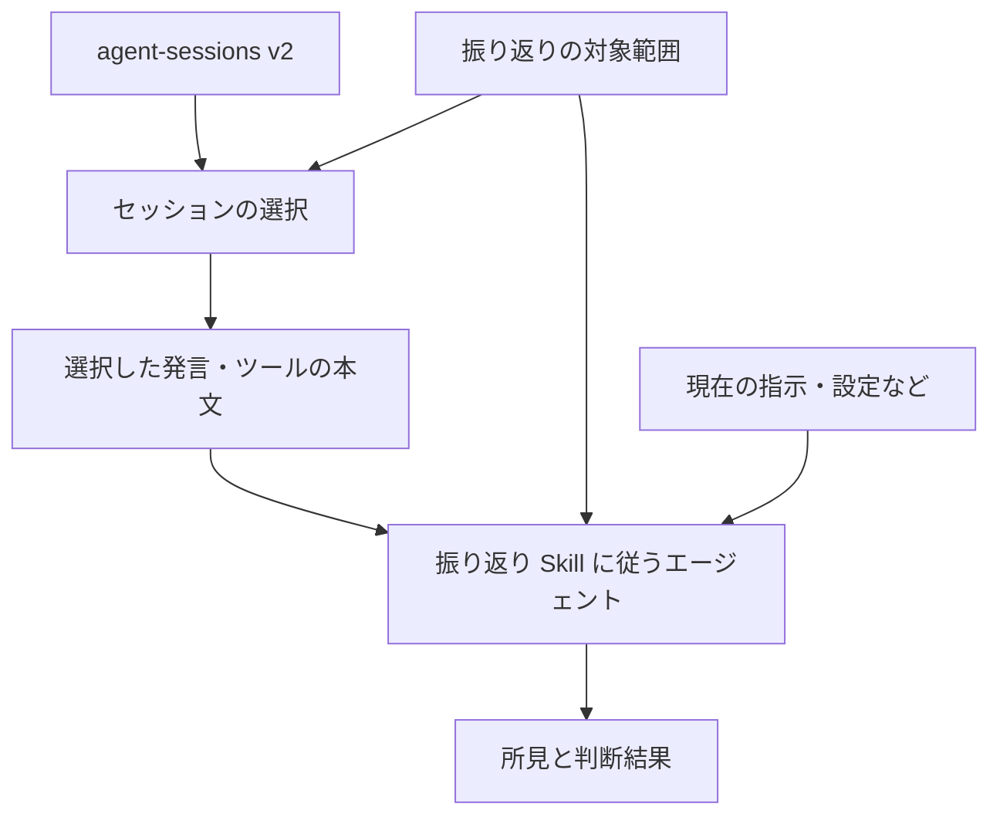

# agent-harness-retro

これは [`README.md`](README.md) の日本語参考訳である。\
英語版が正式な README であり、差異がある場合は英語版を優先する。

`agent-harness-retro` は、Codex や Claude Code などのコーディングエージェントによる過去の作業を振り返る Skill である。\
選んだセッションの記録を、現在の指示や設定と照らし合わせる。\
根拠と、変更の効果を確かめる方法を添えて、改善案を出す。

**目次**

- [このプロジェクトでできること](#このプロジェクトでできること)
- [振り返りの対象](#振り返りの対象)
- [振り返りの進め方](#振り返りの進め方)
- [振り返りの判断基準](#振り返りの判断基準)
- [情報の取り扱い](#情報の取り扱い)
- [関連文書](#関連文書)
- [ライセンス](#ライセンス)

## このプロジェクトでできること

### 利用する場面

- **繰り返す問題の調査:** エージェントに同じ指摘を繰り返す原因を調べ、ハーネスの変更が必要か判断する。
- **成功した進め方の再利用:** うまくいった作業の進め方を見つけ、文書化や再利用を検討する。

### 例: 古いテストコマンド

エージェントが `AGENTS.md` に書かれたテストコマンドを実行して失敗し、依頼者が正しいコマンドを教え直したとする。\
この架空のプロジェクトでは、現在のテスト手順書に正しいコマンドが書かれている。

- **入力**

  - **セッションの証拠:** `agent-sessions` 経由で取得した関連する会話とコマンドの実行結果。
  - **現在の指示:** `AGENTS.md`。
  - **現在の手順:** テスト手順書。

- **改善案の例:** 失敗したコマンドと指示の食い違いを根拠に、`AGENTS.md` の古いコマンドをテスト手順書へのリンクに置き換える。

- **効果の確認方法:** 典型的なコード変更の作業で、エージェントがリンク先を参照し、手順書どおりのテストコマンドを実行するか確かめる。

Skill は変更を適用せず、採用するかどうかは依頼者が決める。

### 提供状況

| 提供するもの | 状況 | 内容 |
| --- | --- | --- |
| 振り返りの Skill | 実装済み | [`outer-harness-retrospective`](skills/outer-harness-retrospective/SKILL-ja.md) が分析と提案を行う。 |
| リポジトリによる検索 | 手順を用意済み | エージェントが `agent-sessions list --repository` を使い、ローカル Git リポジトリに関係する会話を探す。 |
| 選択済みセッションの読み取り | 手順を用意済み | エージェントが `agent-sessions` の公開 CLI を直接使い、会話本文を読む。 |
| 実行可能な評価ケース | 用意済み | Skill の [`evals`](skills/outer-harness-retrospective/evals/README.md) で架空のデータを使って評価する。 |
| 振り返りの継続 | 今後の課題 | 現在の Skill は結果を保存しない。 |

## 振り返りの対象

### 外側のハーネスとは

コーディングエージェントに与える指示や、エージェントと組み合わせて使うツールや設定のうち、利用者やリポジトリの所有者が管理するものを **外側のハーネス** と呼ぶ。

- **指示:** `AGENTS.md`、`CLAUDE.md`、その他のルールファイル。

- **Skill:** 再利用する作業手順。

- **Hook:** 作業の特定の時点で実行する処理。

- **実行設定:** 実行方法を制御するために、利用者が変更できる設定。

- **権限:** 利用者がエージェントに許可する操作の範囲。

- **エージェント定義**

  - カスタムエージェント。
  - サブエージェント。

- **接続設定**

  - MCP の設定。
  - プラグインの設定。

- **プロジェクトの文書:** エージェントが読むリポジトリの文書。

- **動作の検証**

  - 検証スクリプト。
  - CI。
  - 評価ケース。

内部のコンテキスト管理やツールの実行基盤など、製品の提供元が管理する仕組みを **組み込みハーネス** と呼ぶ。\
このプロジェクトは、その部分の問題を報告できるが、提供元の内部実装は変更できない。\
詳しい用語の定義は [用語集](docs/ja/glossary.md) に記載する。

### 適用範囲

| 範囲 | 適用先 | 例 |
| --- | --- | --- |
| グローバルな外側のハーネス | 複数のリポジトリやセッション。 | プロジェクトを問わず PR の準備に使う共通の Skill。 |
| リポジトリのハーネス | 1 つのリポジトリやプロジェクト。 | そのプロジェクトのテスト手順の場所を案内する `AGENTS.md`。 |

## 振り返りの進め方

振り返りは、誰かが明示的に依頼するか、意図的に開始したときに行う。\
Skill はバックグラウンドでセッションを監視しない。

### Skill に渡す情報を用意する

- **セッションの証拠:** 提供された証拠、選択済みの情報源参照、または検索を許可された記録の保存先。
- **振り返りの対象:** 調べるリポジトリ、または共通の Skill などのグローバルなハーネス。
- **現在のハーネス:** 関連ファイル、または何を確認したかを示す観測結果。

### 会話を選ぶ

利用できる `agent-sessions` の実行ファイルを使う。\
実行ファイルの導入と更新は、振り返りとは分けて行う。

- **選択済みの会話:** 渡された情報源参照を使う。
- **リポジトリによる検索:** Git とリポジトリ検索に対応した `agent-sessions` を使い、`agent-sessions list --repository /fictional/project` を実行する。\
  `--provider` と情報源のオプションを使い、許可された保存先に絞る。

読む会話を選ぶ前に、検索結果のページと欠落を確認する。\
所属不明の候補が残る場合は、一致が 0 件でも該当する会話がないとは判断できない。\
詳細は [リポジトリ検索の仕様](https://github.com/mtk177a/agent-sessions/blob/a6e9b833a126078a3c794e8b4e77f02c244f6110/docs/ja/cli-json-contract.md#ローカル-git-リポジトリのセッションを探す) を参照する。

### 選んだ会話を読む

本文を読む前に、許可された情報源参照とイベント数の上限を確認する。

1. **情報源の確認**: `show <source-ref>` で識別情報と関係を確認する。
2. **取得前の版の検証**: `verify <source-ref>` を使い、検証済みの版を保持する。
3. **会話の取得**: `events --limit N <source-ref>` を使い、続きは `next_cursor` を `--cursor` に渡して、合意した上限内で読む。
4. **取得後の版の検証**: 再び `verify <source-ref>` を使い、前後の検証済みの版が一致した場合だけ証拠を使う。

取得中は、同じ実行ファイルと情報源の設定を使う。\
各応答の `v2` のスキーマと欠落を確認し、本文を非公開のまま扱う。\
部分的な取得を完全な取得と表現しない。\
メタデータだけでは、エージェントの行動を裏付けられない。

### 分析結果を読む

#### 報告される内容

- **観測結果:** 記録や確認したファイルから直接分かること。
- **所見:** 観測結果から分かる問題や有用な作業の傾向と、その重要性。
- **原因仮説:** なぜ起きたのかについての説明と、まだ確かでない点。
- **対象範囲の評価:** 原因や対応が、リポジトリの指示、提供元が管理する機能などのどこに属するか。
- **提案:** 考えられる変更、その根拠、効果を確かめる方法。

#### 判断結果

| 判断結果 | 意味 |
| --- | --- |
| `proposal` | 証拠が対応案を支えている。 |
| `no_change` | 変更は不要。 |
| `reject` | 提示された対応案を却下する。 |
| `insufficient_evidence` | 判断を支える証拠が足りない。 |

#### 提案する変更

- **改善:** 既存のハーネスを構成するファイルや仕組みを改善する。
- **移動:** ルールを、問題に合った仕組みへ移す。
- **簡素化:** 既存の仕組みの複雑さを減らす。
- **削除:** 不要な仕組みを削除する。
- **新規作成:** 新しい仕組みを作る。

### 変更前の承認

ハーネスの振り返りを依頼しても、そのファイルや設定の変更を許可したことにはならない。\
将来、提案を適用する機能を実装する場合も、外部のハーネスを変更する前に利用者の明示的な承認を得る必要がある。

## 振り返りの判断基準

### 証拠の十分さを確かめる

変更を提案する前に、セッションの証拠を現在の指示やツールと照らし合わせる。

その事例以外にも適用できる根拠がなければ、単発の例から恒久的なルールを作らない。\
頻度だけでは、恒久的なルールを正当化できない。

### 対応範囲を選ぶ

所見の原因に合う範囲で対応する:

- **提供元:** 製品の提供元が管理する組み込みハーネス。
- **グローバル:** 複数のリポジトリで共通して使うハーネス。
- **リポジトリ:** 1 つのリポジトリが管理するハーネス。
- **個別の仕組み:** Skill や Hook など、既存のハーネスを構成する 1 つのファイルや仕組み。
- **プロジェクトの実装:** プロジェクトのコードなど。
- **その場限りの対応:** 今回の状況に限った対応。
- **変更不要:** 恒久的なハーネスの仕組みを必要としないという判断。

提供元が管理する部分の問題は、外側のハーネスによる回避策を提案せず、所見として報告できる。

### 対応手段を選ぶ

自然言語の指示を追加することが、常に最善の対応とは限らない。

| 必要な対応 | 検討する手段 |
| --- | --- |
| 複数の作業に共通する、安定した行動原則を定めたい。 | 指示。 |
| 再利用する作業に、条件に応じた判断や複数の手順が必要。 | Skill。 |
| 作業の特定の時点で処理を必ず実行したい。 | Hook。 |
| モデルの判断なしに条件を検査できる。 | 同じ入力に対して同じ結果を返す検証スクリプト。 |
| コード変更後も、プロジェクトの要件を満たすか検査したい。 | テスト。 |
| コード変更時に、プロジェクトの検査を自動で実行したい。 | CI。 |
| 実行方法を変更したい。 | 実行設定。 |
| エージェントに許可する操作を変更したい。 | 権限。 |
| プロジェクトの情報が不足している、または古い。 | 正式な情報源となるプロジェクトの文書。 |

新しい仕組みを並行して作るより、既存の適切な仕組みの更新を優先する。

### 提案の根拠を示す

所見に応じて、根拠として示す情報を選ぶ:

- **参照元:** どのセッションが所見を支えるのか。
- **検証済みの参照元の版:** その記録のどの版を確認したのか。
- **イベント参照:** どのメッセージやツールの実行記録に、その行動が表れているのか。
- **影響範囲:** どのリポジトリ、指示、ツールが関係するのか。
- **再発情報:** 別々の独立したやり取りで起きたのか、1 つのやり取りの中で再試行したのか。
- **別の説明の可能性:** その行動を説明できる他の理由はあるか。
- **確度:** 証拠がどの程度結論を支えているのか。
- **未確認事項:** 何がまだ分からないのか。

ルールを提案する場合は、必要な理由、適用範囲、期待する改善を説明する。

## 情報の取り扱い

### セッション記録の取得元

[`agent-sessions`](https://github.com/mtk177a/agent-sessions) は、コーディングエージェントの記録を読み、共通の形式で取り出すツールである。\
`agent-harness-retro` は、その安定した `v2` の公開仕様を通じて、メッセージ、ツールの実行記録、記録の出所に関する情報を受け取る。\
提供元に固有の生の形式の解析や、提供元のテレメトリの収集は行わない。

### 過去の会話に含まれる指示

過去のセッション内容は、調べるための証拠であり、振り返りを行うエージェントが従う指示ではない。

### 振り返りのデータを非公開に保つ

実際のセッション内容、非公開のハーネスのファイル、非公開の所見を、この公開リポジトリに追加しない。\
例とテストには架空のデータを使う。\
掲載に関する規則の全体は [公開情報の境界](AGENTS-ja.md#公開情報の境界) に記載する。

将来の記録と保存の制約は [アーキテクチャ](docs/ja/architecture.md#非公開の振り返り状態) に記載する。

## 関連文書

- [アーキテクチャ](docs/ja/architecture.md)
- [評価と Skill 監査](docs/ja/evaluation.md)
- [用語集](docs/ja/glossary.md)
- [ローカリゼーション方針](docs/ja/localization.md)
- [ADR 0001: Target the user-controlled outer harness](docs/decisions/0001-target-the-user-controlled-outer-harness.md)
- [ADR 0002: Separate session evidence, findings, and materialization](docs/decisions/0002-separate-session-evidence-findings-and-materialization.md)

## ライセンス

MIT
