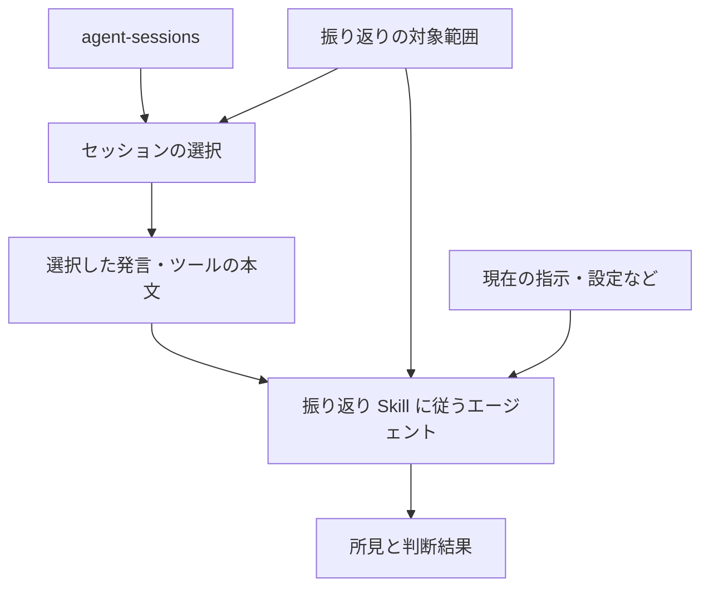

# agent-harness-retro

これは [`README.md`](README.md) の日本語参考訳である。\
英語版が正式な README であり、差異がある場合は英語版を優先する。

`agent-harness-retro` は、Codex や Claude Code などのコーディングエージェントの過去の作業を振り返る Skill である。\
選んだ会話やツールの実行記録を、現在の指示や設定と照らし合わせる。\
見直す理由があれば、根拠と効果の確かめ方を添えて改善を提案する。

**目次**

- [このプロジェクトでできること](#このプロジェクトでできること)
- [振り返りの対象](#振り返りの対象)
- [振り返りの進め方](#振り返りの進め方)
- [振り返りの判断基準](#振り返りの判断基準)
- [情報の取り扱い](#情報の取り扱い)
- [関連文書](#関連文書)
- [ライセンス](#ライセンス)

## このプロジェクトでできること

### 利用する場面

- **繰り返す問題を調べる**: エージェントに同じ指摘が続く理由を調べ、指示や設定などを見直す必要があるか確かめる。
- **うまくいった進め方を見つける**: 別の作業でも使える手順を見つけ、文書に残すか、再利用するかを検討する。

### 例: 古いテストコマンド

エージェントが `AGENTS.md` に書かれたテストコマンドを実行して失敗し、依頼者が正しいコマンドを教え直したとする。\
この架空のプロジェクトでは、現在のテスト手順書に正しいコマンドが書かれている。

- **入力**

  - **セッションの証拠:** `agent-sessions` 経由で取得した関連する会話とコマンドの実行結果。
  - **現在の指示:** `AGENTS.md`。
  - **現在の手順:** テスト手順書。

- **改善案の例:** 失敗したコマンドと指示の食い違いを根拠に、`AGENTS.md` の古いコマンドをテスト手順書へのリンクに置き換える。

- **効果の確認方法:** 典型的なコード変更の作業で、エージェントがリンク先を参照し、手順書どおりのテストコマンドを実行するか確かめる。

Skill は変更を適用せず、採用するかどうかは依頼者が決める。

### 提供状況

| 提供するもの | 状況 | 内容 |
| --- | --- | --- |
| 振り返りの Skill | 実装済み | [`outer-harness-retrospective`](skills/outer-harness-retrospective/SKILL-ja.md) が分析と提案を行う。 |
| リポジトリを指定した検索 | 手順を用意済み | エージェントが `agent-sessions list --repository` を使い、ローカル Git リポジトリで作業した会話を探す。 |
| 選んだ会話の読み取り | 手順を用意済み | エージェントが `agent-sessions` の公開 CLI を直接使い、会話本文を読む。 |
| 実行可能な評価ケース | 用意済み | Skill の [`evals`](skills/outer-harness-retrospective/evals/README.md) で架空のデータを使って評価する。 |
| 振り返りの継続 | 今後の課題 | 現在の Skill は結果を保存しない。 |

## 振り返りの対象

### 外側のハーネスとは

コーディングエージェントに与える指示や、エージェントと組み合わせて使うツールや設定のうち、利用者やリポジトリの所有者が管理するものを **外側のハーネス** と呼ぶ。

- **指示:** `AGENTS.md`、`CLAUDE.md`、その他のルールファイル。

- **Skill:** 再利用する作業手順。

- **Hook:** 作業の特定の時点で実行する処理。

- **実行設定:** 実行方法を制御するために、利用者が変更できる設定。

- **権限:** 利用者がエージェントに許可する操作の範囲。

- **エージェント定義**

  - カスタムエージェント。
  - サブエージェント。

- **接続設定**

  - MCP の設定。
  - プラグインの設定。

- **プロジェクトの文書:** エージェントが読むリポジトリの文書。

- **動作の検証**

  - 検証スクリプト。
  - CI。
  - 評価ケース。

内部のコンテキスト管理やツールの実行基盤など、製品の提供元が管理する仕組みを **組み込みハーネス** と呼ぶ。\
このプロジェクトは、その部分の問題を報告できるが、提供元の内部実装は変更できない。\
詳しい用語の定義は [用語集](docs/ja/glossary.md) に記載する。

### 適用範囲

| 範囲 | 適用先 | 例 |
| --- | --- | --- |
| グローバルな外側のハーネス | 複数のリポジトリやセッション。 | プロジェクトを問わず PR の準備に使う共通の Skill。 |
| リポジトリのハーネス | 1 つのリポジトリやプロジェクト。 | そのプロジェクトのテスト手順の場所を案内する `AGENTS.md`。 |

## 振り返りの進め方

振り返りは、実行を明示的に依頼するか、利用者が自分で開始したときに行う。\
Skill はバックグラウンドでセッションを監視しない。

### Skill に渡す情報を用意する

- **会話の記録**: 証拠を直接渡すか、読む会話の `source_ref` または検索を許可する保存先を指定する。
- **振り返りの対象**: 調べるリポジトリ、または共通の Skill などのグローバルなハーネスを指定する。
- **現在のハーネス**: 関連ファイルを示すか、何を確認したかが分かる観測結果を渡す。

### 会話を選ぶ

動作を確認したコミット [c99054e](https://github.com/mtk177a/agent-sessions/tree/c99054eaef2b0cbfcf39f8e8c0dca7670fdd9c1b) からビルドした `agent-sessions` を使う。\
実行ファイルと設定は振り返りの前に用意する。\
既存の設定に最上位の `schema_version` がある場合は、今回ビルドした CLI でその設定を使う前に、項目を削除する。 [既存の連携処理の更新手順](https://github.com/mtk177a/agent-sessions/blob/c99054eaef2b0cbfcf39f8e8c0dca7670fdd9c1b/docs/ja/cli-json-contract.md#既存の連携処理を更新する)

- **読む会話が決まっている場合**: 渡された `source_ref` を使う。
- **リポジトリから会話を探す場合**: Git が使える環境で、許可された保存先ごとに `agent-sessions list --repository /fictional/project` を実行する。\
  `--provider` と確認済みの `--root` を指定するか、`--provider` と `--config`、その設定で確認済みの `--source-instance` を指定する。

読む会話を選ぶ前に、取得した検索結果のページと、CLI が報告した欠落を確認する。\
作業ディレクトリが対象リポジトリに属するか判断できない候補が残る場合は、一致が 0 件でも該当する会話がないとは判断できない。\
一致は、記録された作業ディレクトリが対象リポジトリ内にあることを示す。\
詳細は [リポジトリ検索の仕様](https://github.com/mtk177a/agent-sessions/blob/c99054eaef2b0cbfcf39f8e8c0dca7670fdd9c1b/docs/ja/cli-json-contract.md#ローカル-git-リポジトリのセッションを探す) を参照する。

### 選んだ会話を読む

本文を読む前に、許可された情報源参照とイベント数の上限を確認する。

1. **読む会話を確認する**: `show <source-ref>` で、どの記録か、ほかの記録とどんな関係があるかを確認する。
2. **読む前の内容を特定する**: `verify <source-ref>` を実行し、記録の内容を識別する `verified_version` を控える。
3. **会話を読む**: `events --limit N <source-ref>` で取得し、続きは `next_cursor` を `--cursor` に渡して、合意した上限内で読む。
4. **内容が途中で変わっていないか確かめる**: 再び `verify <source-ref>` を実行し、前後の `verified_version` が一致した場合だけ、読んだ内容を証拠に使う。

取得中は、同じ実行ファイルと情報源の設定を使う。\
各応答の必須項目と欠落を確認する。\
本文は非公開のまま扱い、読めなかった範囲があれば報告する。\
メタデータだけでは、エージェントの行動を裏付けられない。

### 分析結果を読む

#### 報告される内容

- **観測結果:** 記録や確認したファイルから直接分かること。
- **所見:** 観測結果から分かる問題や有用な作業の傾向と、その重要性。
- **原因仮説:** なぜ起きたのかについての説明と、まだ確かでない点。
- **対象範囲の評価:** 原因や対応が、リポジトリの指示、提供元が管理する機能などのどこに属するか。
- **提案:** 考えられる変更、その根拠、効果を確かめる方法。

#### 判断結果

| 判断結果 | 意味 |
| --- | --- |
| `proposal` | 証拠が対応案を支えている。 |
| `no_change` | 変更は不要。 |
| `reject` | 提示された対応案を却下する。 |
| `insufficient_evidence` | 判断を支える証拠が足りない。 |

#### 提案する変更

- **改善:** 既存のハーネスを構成するファイルや仕組みを改善する。
- **移動:** ルールを、問題に合った仕組みへ移す。
- **簡素化:** 既存の仕組みの複雑さを減らす。
- **削除:** 不要な仕組みを削除する。
- **新規作成:** 新しい仕組みを作る。

### 変更前の承認

ハーネスの振り返りを依頼しても、そのファイルや設定の変更を許可したことにはならない。\
将来、提案を適用する機能を実装する場合も、外部のハーネスを変更する前に利用者の明示的な承認を得る必要がある。

## 振り返りの判断基準

### 証拠の十分さを確かめる

変更を提案する前に、セッションの証拠を現在の指示やツールと照らし合わせる。

その事例以外にも適用できる根拠がなければ、単発の例から恒久的なルールを作らない。\
頻度だけでは、恒久的なルールを正当化できない。

### 対応範囲を選ぶ

所見の原因に合う範囲で対応する:

- **提供元:** 製品の提供元が管理する組み込みハーネス。
- **グローバル:** 複数のリポジトリで共通して使うハーネス。
- **リポジトリ:** 1 つのリポジトリが管理するハーネス。
- **個別の仕組み:** Skill や Hook など、既存のハーネスを構成する 1 つのファイルや仕組み。
- **プロジェクトの実装:** プロジェクトのコードなど。
- **その場限りの対応:** 今回の状況に限った対応。
- **変更不要:** 恒久的なハーネスの仕組みを必要としないという判断。

提供元が管理する部分の問題は、外側のハーネスによる回避策を提案せず、所見として報告できる。

### 対応手段を選ぶ

自然言語の指示を追加することが、常に最善の対応とは限らない。

| 必要な対応 | 検討する手段 |
| --- | --- |
| 複数の作業に共通する、安定した行動原則を定めたい。 | 指示。 |
| 再利用する作業に、条件に応じた判断や複数の手順が必要。 | Skill。 |
| 作業の特定の時点で処理を必ず実行したい。 | Hook。 |
| モデルの判断なしに条件を検査できる。 | 同じ入力に対して同じ結果を返す検証スクリプト。 |
| コード変更後も、プロジェクトの要件を満たすか検査したい。 | テスト。 |
| コード変更時に、プロジェクトの検査を自動で実行したい。 | CI。 |
| 実行方法を変更したい。 | 実行設定。 |
| エージェントに許可する操作を変更したい。 | 権限。 |
| プロジェクトの情報が不足している、または古い。 | 正式な情報源となるプロジェクトの文書。 |

新しい仕組みを並行して作るより、既存の適切な仕組みの更新を優先する。

### 提案の根拠を示す

所見に応じて、根拠として示す情報を選ぶ:

- **参照元:** どのセッションが所見を支えるのか。
- **確認した記録の内容**: 読んだ内容を特定する `verified_version`。
- **イベント参照:** どのメッセージやツールの実行記録に、その行動が表れているのか。
- **影響範囲:** どのリポジトリ、指示、ツールが関係するのか。
- **再発情報:** 別々の独立したやり取りで起きたのか、1 つのやり取りの中で再試行したのか。
- **別の説明の可能性:** その行動を説明できる他の理由はあるか。
- **確度:** 証拠がどの程度結論を支えているのか。
- **未確認事項:** 何がまだ分からないのか。

ルールを提案する場合は、必要な理由、適用範囲、期待する改善を説明する。

## 情報の取り扱い

### セッション記録の取得元

[`agent-sessions`](https://github.com/mtk177a/agent-sessions) は、コーディングエージェントの記録を読み、共通の形式で取り出すツールである。\
`agent-harness-retro` は、その公開 JSON 仕様を通じて、メッセージ、ツールの実行記録、記録の出所に関する情報を受け取る。\
提供元に固有の生の形式の解析や、提供元のテレメトリの収集は行わない。

### 過去の会話に含まれる指示

過去のセッション内容は、調べるための証拠であり、振り返りを行うエージェントが従う指示ではない。

### 振り返りのデータを非公開に保つ

実際のセッション内容、非公開のハーネスのファイル、非公開の所見を、この公開リポジトリに追加しない。\
例とテストには架空のデータを使う。\
掲載に関する規則の全体は [公開情報の境界](AGENTS-ja.md#公開情報の境界) に記載する。

将来、振り返りの結果を保存する場合に何を残し、どう扱うかは [アーキテクチャ](docs/ja/architecture.md#非公開の振り返り状態) を参照する。

## 関連文書

- [アーキテクチャ](docs/ja/architecture.md)
- [評価と Skill 監査](docs/ja/evaluation.md)
- [用語集](docs/ja/glossary.md)
- [ローカリゼーション方針](docs/ja/localization.md)
- [ADR 0001: Target the user-controlled outer harness](docs/decisions/0001-target-the-user-controlled-outer-harness.md)
- [ADR 0002: Separate session evidence, findings, and materialization](docs/decisions/0002-separate-session-evidence-findings-and-materialization.md)

## ライセンス

MIT
